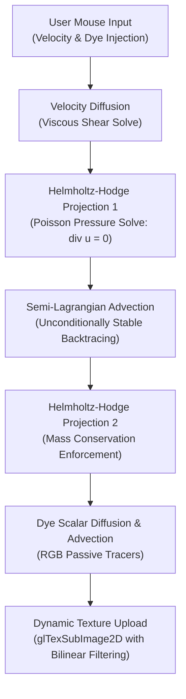

# Tiny Fluid Simulator

[](https://en.wikipedia.org/wiki/C%2B%2B17)
[](https://www.opengl.org)
[](https://en.wikipedia.org/wiki/Navier%E2%80%93Stokes_equations)
[](LICENSE)

A real-time 2D Eulerian fluid dynamics simulator in modern C++17 and OpenGL 3.3 Core Profile based on Jos Stam's seminal *Stable Fluids* method. Numerically integrates the incompressible Navier-Stokes equations on an interactive $160 \times 160$ staggered grid with semi-Lagrangian advection, iterative Gauss-Seidel pressure Poisson projection, and real-time GPU texture streaming.

---

## Navier-Stokes Numerical Pipeline

The simulation solves the velocity and scalar transport equations for incompressible flow:

$$\frac{\partial \mathbf{u}}{\partial t} = -(\mathbf{u} \cdot \nabla)\mathbf{u} + \nu \nabla^2 \mathbf{u} - \frac{1}{\rho}\nabla p + \mathbf{f}, \quad \nabla \cdot \mathbf{u} = 0$$



---

## Technical Features

- **Unconditional Numerical Stability:** Semi-Lagrangian advection backtraces velocity trajectories using bilinear spatial interpolation, preventing numerical explosion regardless of timestep size ($\Delta t$).
- **Mass Conservation & Incompressibility:** Enforces $\nabla \cdot \mathbf{u} = 0$ via Helmholtz-Hodge decomposition, using 20 relaxation iterations of the Gauss-Seidel method to solve the Poisson pressure field.
- **Dynamic GPU Texture Streaming:** Extracts RGB density fields into an aligned pixel buffer and streams it to a GPU texture using `glTexSubImage2D` with hardware bilinear interpolation.
- **Color Palettes & Diagnostics:**
  - Dynamic RGB Rainbow hue cycling based on HSV color space mathematics.
  - Thermal Fire & Magma palette.
  - Deep Ocean current palette.
  - Direct velocity vector field visualization mode.

---

## Controls

| Key / Input | Action |
| :--- | :--- |
| **Left Click + Drag** | Inject fluid velocity and colored dye |
| **Right Click + Drag** | Stir fluid velocity without injecting dye |
| **Up / Down Arrows** | Adjust mouse brush radius ($2\text{px} - 15\text{px}$) |
| **V** | Toggle velocity vector field visualization |
| **1 / 2 / 3** | Color palette: Rainbow / Fire & Magma / Ocean |
| **C / Space** | Clear fluid grid state |
| **Escape** | Cleanly exit application |

---

## Prerequisites

- **Compiler:** GCC 9+, Clang 10+, or MSVC 2019+ (C++17)
- **Build System:** CMake 3.20+
- **Windowing:** GLFW 3 (`libglfw3-dev`)
- **OpenGL:** Development headers (`libgl-dev`)

---

## Build & Run

```bash
cd TinyFluidSimulator
cmake -B build -S . -DCMAKE_BUILD_TYPE=Release
cmake --build build -j$(nproc)
./build/TinyFluidSimulator
```

---

## License

Distributed under the [MIT License](LICENSE).
